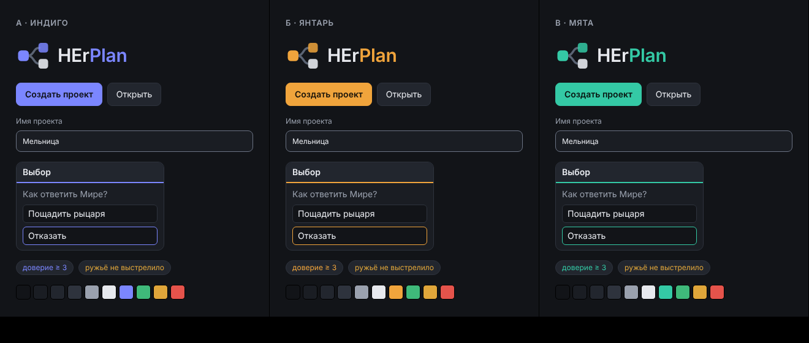

# Бренд HErPlan (задача Ф1-03)

Статус: **утверждено владельцем 2026-10-18.**

## Решение

- Владельцу понравились все три акцента, поэтому в приложении есть **все три**: акцент переключается в настройках («Оформление → Акцент») и сразу меняет кнопки, выделение и логотип в окне.
- **По умолчанию — мята** (выбор владельца). Мятой нарисован значок программы (панель задач, ярлык, установщик), потому что значок у Windows-приложения один.
- В теме «Янтарь» предупреждения лимонные (`#d8d24a`), чтобы не путаться с акцентом.

| файл | что это |
| --- | --- |
| `logo-mark.svg` | знак (мята) |
| `icon.svg`, `icon-small.svg` | значок программы: полный (от 40 px) и упрощённый для 16–32 px |
| `palette-*.json` | цвета трёх акцентов и пары для проверки контраста |
| `preview.html`, `palette-options.png` | сравнение вариантов, показанное владельцу |
| [`app/src/ui/theme/tokens.css`](../../app/src/ui/theme/tokens.css) | токены в приложении |

Значки пересобираются командой `node scripts/render-icons.mjs` из папки `app/`.

## Варианты, которые сравнивались

Общая тёмная нейтральная основа и три акцента: **А — индиго**, **Б — янтарь**, **В — мята**. Синий и оранжевый оригинала сознательно не используются.

- Все пары цветов проверены по WCAG 2.2 (`palette-*.json`, проверка `contrast.py`): текст — не ниже AA (основной текст 12–15:1), элементы интерфейса и рамки полей — не ниже 3:1. Линия-разделитель `line` декоративная и под требование не подпадает.
- В варианте Б акцент совпадал по тону с цветом предупреждений, поэтому там предупреждения лимонные.
- Логотип — ветвящийся граф (один узел расходится на два, как сюжет с выбором) и надпись «HEr**Plan**». Только простые фигуры, без градиентов и теней: читается и в 16 px (значок в панели задач), и в 512 px.
- Шрифт интерфейса — системный (Segoe UI на Windows): не нужно ничего встраивать, и он быстрее всего отрисовывается на слабых ПК.

Предпросмотр собирается из `preview.html` (Chromium).
